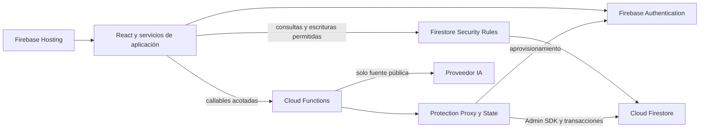

> **AVISO DE VIGENCIA — R3 (13/11/2026)**
>
> Este archivo conserva la **auditoría técnica R2 de Codex**, basada en el repositorio en revisión `398e42d` (11–12/11/2026), como evidencia de situación inicial. **No se re-auditó el HEAD actual de GitHub ni `animappv1`**. Los hallazgos y 16 RF deben contrastarse con commits futuros; no asumir que se resolvieron por existir FB-001.
>
> El texto R2 puede recomendar Express en apartados históricos, emuladores o ramas/PR. **Esas propuestas no son instrucciones operativas actuales.** La arquitectura BaaS está en la sección de decisión R2; la modalidad vigente está en `DECISIONES_EQUIPO_R3.md`, y las tareas vigentes en `PLAN_FINALIZACION_TFI.md` R3.
>
> FB-003 se ejecutó después de la foto R2 en una copia local (63 tests de aislamiento informados), pero el equipo decidió **no adoptarla en el flujo compartido**. La evidencia de R2 sobre ausencia de emuladores en el HEAD antiguo es histórica, no una afirmación sobre la copia local posterior.
>
> **Resultado de referencia:** 0/16 RF completamente verificados en la auditoría R2; 5 implementados sin verificar, 9 parciales, 2 ausentes. No inferir que ese conteo sigue describiendo `main` en fecha posterior sin nueva auditoría.

---

# AnimApp — Auditoría técnica integral del TFI

Fecha: 11/11/2026. Repositorio local, rama `main`, revisión `398e42d`. Especificación: prompt del equipo para UTN FR Resistencia. No se encontraron Idea Proyecto, Plan de Trabajo originales, diagramas Figma ni exportaciones Jira en el repositorio. Sus compromisos se toman del prompt y deben contrastarse con los originales. No se atribuye autoría del código a ninguno de los integrantes.

## Revisión R2 — Replanificación BaaS (12/11/2026)

El equipo eligió Firebase BaaS y descartó la API Express completa. **La elección técnica está tomada por el equipo; su aceptación por la cátedra no está confirmada.** HEAD sigue en `398e42d`; la comparación de `src`, dependencias, configuración e índices/reglas frente a esa revisión no presenta diferencias. Solo existen los dos Markdown como archivos nuevos no versionados. Se reutilizan las evidencias R1 sin repetir pruebas ni acceder al proyecto Firebase real. Se revisaron puntualmente reglas de usuarios/alumnos/rutinas y el guardado del editor para diseñar las fronteras de seguridad.

No hay nueva prueba funcional: los estados de los 16 RF permanecen **0 completos/verificados, 5 implementados/no verificados, 9 parciales y 2 no implementados** (0 bloqueados como categoría principal). H-01–H-10 y H-12–H-14 siguen vigentes; H-11 sigue parcialmente resuelto por configuración, no por una corrección del código. La ausencia de Express deja de ser un faltante técnico del plan elegido, pero la discrepancia académica sigue abierta. El SDK inicializado, build/lint y HTTP 200 son evidencias previas, no pruebas nuevamente ejecutadas hoy ni demostración de renderizado.

La sección **Decisión arquitectónica: Firebase BaaS** reemplaza las recomendaciones Express anteriores. El nuevo plan tiene **33 tareas: 167 h optimistas, 210 h base y 287 h conservadoras, calculadas por tarea**. Los IDs TFI-001…036 conservados en fichas y hallazgos son referencias históricas: su reemplazo vigente está en la tabla de correspondencia del plan. Sus horas antiguas no se deben sumar ni usar como estimación BaaS. R1 se conserva como registro histórico; su decisión de mantener 248 h quedó sustituida por R2.

## Revisión R1 — Actualización posterior a configurar Firebase (11/11/2026)

**Motivo:** sustituir el diagnóstico de configuración vacía por evidencia actual sin confundir inicialización con funcionamiento integral. La auditoría inicial reprodujo `auth/invalid-api-key`; los valores se cargaron en la intervención de arranque anterior, no en esta revisión. Esta revisión solo modifica los dos documentos.

**Nueva evidencia:** seis variables completas, SDK App/Auth/Firestore inicializado y estado Auth resuelto sin usuario; `.env` continúa ignorado/no versionado. Vite existente responde HTTP 200 para página pública y módulo App. Build y lint nuevamente satisfactorios. Fuentes, reglas y configuración versionadas siguen iguales a HEAD `398e42d`; por tanto los hallazgos de implementación continúan siendo aplicables. No se imprimieron valores sensibles.

**React y consola:** no verificados. Se intentó inventario del navegador y se obtuvo host no disponible; el acceso alternativo a la aplicación nativa Google Chrome agotó el tiempo. No se obtuvo DOM, imagen ni consola. No se infiere render de HTTP 200, build o SDK inicializado.

**Seguridad del entorno:** no hay configuración de emuladores en `firebase.json`, llamadas de conexión a emuladores en fuentes, scripts de tests ni CLI Firebase disponible en PATH. No se detectaron servicios en puertos habituales 4000/4400/8080/9099. La configuración efectiva no usa un ID `demo-`; eso por sí solo no prueba producción, pero tampoco demuestra aislamiento. No se encontró evidencia suficiente de un proyecto de pruebas independiente. Tratar el proyecto configurado como potencialmente conectado a datos existentes. No se instalaron ni configuraron emuladores, no se crearon fixtures y no se probaron operaciones remotas.

**Pruebas seguras ejecutadas:** comprobación de presencia de valores, inicialización local del SDK y estado Auth sin login, inspección de configuración/listeners, HTTP local, build y lint. No se consultó Firestore ni se autenticaron usuarios; no se abrieron administración o recepción ni se ejecutaron sus componentes. El riesgo H-04 impide usarlos como prueba exploratoria contra datos existentes.

| Hallazgos previos | Resultado R1 | Razón |
|---|---|---|
| Configuración local vacía / `auth/invalid-api-key` | Resuelto para esta instalación | Seis valores presentes y SDK inicializado sin error |
| H-11 completo | Parcialmente resuelto | Configuración corregida; robustez ante configuración inválida aún sin implementar |
| H-01–H-10 | Vigentes | Reglas y fuentes sin cambios; permisos, backfills, historial, relaciones y faltantes funcionales no se resuelven configurando SDK |
| H-12–H-14 | Vigentes | Validaciones/errores, contenido institucional y módulos opcionales no cambiaron |
| Render, consola, RNF-02/03/04 | Sin nueva validación suficiente | Sin acceso operativo al navegador ni servicio IA real |
| Entorno aislado y pruebas de autorización | Pendientes | Ningún aislamiento comprobado; no se arriesgaron datos existentes |

**Clasificación de RF:** los 16 conservan exactamente su estado. RF-05 recibe evidencia de una precondición (SDK inicializado), no de autenticación completa. RF-14 recibe HTTP público, no prueba de interacción de visitante/autenticado. Los demás no obtuvieron nuevas pruebas funcionales. Conteo inalterado: 0 completos/verificados, 5 implementados/no verificados, 9 parciales, 2 no implementados y 0 bloqueados como estado principal.

**Impacto histórico R1 (sustituido por R2):** en esa revisión se mantuvo la estimación base de 248 h-persona y sus 36 tareas. La carga manual de configuración no tenía una estimación separada; no corresponde restar horas arbitrarias ni cerrar tareas compuestas de sesión o emuladores. No cambia el reparto ni la prioridad crítica de seguridad/datos. El siguiente paso de verificación es habilitar un entorno aislado y acceso a navegador; hacerlo no exige adelantar todas las funcionalidades del backend. La trazabilidad de esa decisión está preservada en el mapeo del plan R2.

## A. Resumen ejecutivo

AnimApp tiene una base frontend considerable: navegación por roles, autenticación Firebase, administración de cuentas, recepción, asignación de profesores, biblioteca de ejercicios y editor de rutinas por semanas, días y etapas. Existen lecturas y escrituras reales de Firestore; no es solamente una maqueta. Sin embargo, el flujo central no está terminado: el alumno ve una constante de demostración, el profesor sobrescribe una rutina por alumno y no hay historial persistente ni transiciones de estado protegidas.

Arevalito es un FAQ determinista con expresiones regulares, sin servicio de IA. La información institucional está en constantes, sin administración persistente. No hay backend Express ni API REST propia. La arquitectura real difiere de la comprometida; Firestore es documental, no relacional.

Los riesgos principales son lecturas propias permitidas a usuarios inactivos, falta de validación confiable de asignaciones y titulares, ausencia de protección del historial y sincronizaciones automáticas capaces de sobrescribir fichas por carreras entre listeners. Reasignar un profesor puede impedir que el nuevo guarde la rutina existente. Las reglas locales no demuestran cuáles están desplegadas.

Resultado: **0 RF completos y verificados; 5 implementados no verificados; 9 parciales; 2 no implementados; 0 clasificados primariamente como bloqueados**. La configuración local de Firebase ya no bloquea la inicialización del SDK. La verificación integrada sigue pendiente por falta de un entorno aislado comprobado y acceso operativo al navegador; esto no oculta los faltantes visibles en código.

Build y lint pasan. Tras cargar los seis valores reales en una intervención anterior, `.env` está completo y la nueva prueba local inicializa App, Auth y Firestore sin `auth/invalid-api-key`. Esto no demuestra login real, autorización remota ni renderizado. No hay suite de pruebas ni emuladores configurados. No se verificaron interfaz, accesibilidad, responsividad, permisos ejecutados ni latencia real. El proyecto necesita una etapa sustancial de desarrollo y validación, no solo ajustes finales. El plan R2 elegido por el equipo conserva Firebase BaaS y estima **210 horas-persona base** con escenarios por tarea. La aceptación académica del cambio sigue pendiente. No son horas ya consumidas ni se deducen de las 285 originales.

## Alcance, metodología y límites de verificación

Se inspeccionaron fuentes, configuraciones, rutas, dependencias, operaciones Firebase, reglas, índices, estado Git y documentación local; se reconstruyeron flujos y se ejecutaron comprobaciones sin escribir datos externos. Se excluyeron binarios y dependencias de las búsquedas generales. No se modificaron código, `.env`, reglas, ramas, commits ni infraestructura. Solo se redactan estos dos Markdown. `build` regenera `dist`, artefacto ignorado y no entregable de auditoría.

| Comprobación | Resultado observado | Alcance y limitación |
|---|---|---|
| `npm ls --depth=0` | Sin dependencias faltantes reportadas; React 19.2.8, Vite 8.2.1, Firebase 12.17.1 | Instalación local; no certifica ausencia de vulnerabilidades |
| `npm run build` | Éxito, 1840 módulos; JS principal 881.31 kB / gzip 259.98 kB | Advertencia de chunk >500 kB. No prueba runtime |
| `npm run lint` | Éxito sin diagnósticos | Configuración oxlint acotada; no prueba permisos ni negocio |
| Node/npm | 24.19.0 / 11.17.0 | No hay versión fijada en el proyecto |
| Variables de entorno | Revisión R1: seis claves esperadas con valores; nombres coinciden con código | Valores no impresos; `.env` ignorado y no versionado; `.env.example` conserva valores vacíos |
| Inicialización SDK en Node con `loadEnv` | R1: App/Auth/Firestore inicializados; `authStateReady` resuelve sin usuario autenticado | Sin login, lecturas/escrituras remotas ni prueba de credenciales de usuario; no certifica configuración del servicio remoto |
| Git | R1: HEAD `398e42d`; fuentes/reglas/configuración versionadas sin diferencias frente a HEAD; `docs/` sigue sin versionar | `.env` ignorado; solo `.env.example` versionado; no se inspeccionó todo el historial de secretos |
| Puerto 5173 / HTTP | R1: listener local existente; `/` y `/src/App.jsx` responden HTTP 200 | Se conservó el servidor existente; intento adicional de inicio rechazado por puerto ocupado. HTTP no demuestra renderizado |
| Navegador | R1: host de navegador no disponible; intento alternativo de acceso nativo a Chrome agotó tiempo | No se obtuvo página, captura ni consola. React renderizado sigue sin verificar; no se navegaron paneles |
| Tests / aislamiento | R1: sin scripts/tests, configuración `emulators` ni conexiones `connect*Emulator` en fuentes | CLI `firebase` no encontrado en PATH; sin listeners en puertos habituales 4000/4400/8080/9099. No demuestra ausencia de emuladores en puertos distintos o en otras carpetas |
| Reglas e índices | Análisis estático de archivos locales | No se ejecutaron reglas en emulador ni se contrastaron reglas/índices desplegados |
| FAQ puro | Cuatro consultas ejecutadas en memoria con funciones existentes | No monta React ni mide red o interfaz; resultados abajo |
| Entorno externo | No se consultaron datos Firebase, Jira, Figma o GitHub remoto | No se verificaron proveedores Auth, usuarios, facturación, CI remoto ni despliegue |

Prueba aislada de `answerQuestion` (sin cambios de fuentes):

- «¿Dónde queda Moreno?» → «La sede Moreno está en Moreno.»: dirección incompleta comprobada.
- «¿Cuál es mi rutina privada?» → respuesta de alcance limitado: no consulta datos personales.
- «Necesito un plan personalizado para mi lesión» → planes comerciales: clasificación incorrecta, no rechazo explícito del pedido fuera de alcance.
- «Hola, ¿cuánto cuesta el pase?» → saludo, omite precio: el orden de las expresiones regulares pierde la intención.

### Clasificación de causas

| Origen | Hallazgo | Implicación |
|---|---|---|
| Configuración local / valores faltantes | Resuelto en R1: seis variables completas e inicialización SDK exitosa | Se retira este bloqueo local; permanecen sin comprobar sesión remota, permisos y renderizado |
| Código de aplicación | `rutinaDemo`, sobrescritura, backfills, perfil desactualizado | Requiere desarrollo incluso con credenciales correctas |
| Seguridad y permisos | Lecturas sin estado activo, IDs manipulables, historial editable | Debe corregirse y probarse en capa confiable |
| Dependencia no implementada | IA, mantenimiento institucional y Functions justificadas del plan BaaS | No se resuelve agregando `.env`; Express ya no es pendiente técnico, sí discrepancia académica |
| Infraestructura externa | Estado de Auth, reglas, índices, hosting y proveedor IA desconocido | Verificar posteriormente en entorno autorizado, sin asumir fallo actual del proveedor |
| Herramientas de comprobación | Sin emuladores ni navegación operativa comprobada | Limita el grado de certeza dinámica |

## B. Matriz completa de RF

Abreviaturas de archivos para referencias de línea: **AD** `src/pages/AdminDashboard.jsx`; **RD** `src/pages/RecepcionDashboard.jsx`; **AC** `src/context/AuthContext.jsx`; **RW** `src/components/RoutineWorkspace.jsx`; **AL** `src/pages/AlumnoDashboard.jsx`; **CH** `src/components/ArevalitoChat.jsx`; **PR** `src/components/ProtectedRoute.jsx`; **FR** `firestore.rules`; **DA** `src/constants/appData.js`. Las líneas corresponden a la revisión auditada, no a archivos propuestos.

Las columnas TFI y horas de esta matriz preservan la trazabilidad histórica del diagnóstico inicial: **no son la estimación vigente**. La tabla de correspondencia del plan R2 enlaza cada TFI con FB-001…033 y sus nuevas horas. Los estados y evidencias de código siguen vigentes; las soluciones referidas a REST/Express en fichas anteriores se sustituyen por la decisión BaaS de este documento. No sumar horas compartidas entre RF.

| RF | Estado principal | Evidencia concreta | Pendiente esencial | Prioridad | Paquetes históricos Express (sustituidos en R2) |
|---|---|---|---|---|---|
| RF-01 | Implementado, no verificado | AD 275–379, `handleSavePerson`, cuenta secundaria y batch de perfil/ficha | Probar alta y recuperación; validar roles/sedes en servidor; acordar alta de administradores | Alta | TFI-011/014/019: 22 h |
| RF-02 | Parcial | AD 125–195, 293–325; filtro excluye admin 137 | Integridad al cambiar rol/sede, cobertura de usuarios admin, evitar backfill destructivo | Alta | TFI-012/014/016/019: 28 h |
| RF-03 | Implementado, no verificado | RD 237–270 fija `rol: alumno`, sede y UID | Probar permisos, duplicaciones, compensación y restricciones de alta | Alta | TFI-011/015/019: 26 h |
| RF-04 | Parcial | RD 46–61, 194–235 | Nombre/teléfono de ficha y perfil divergen; validación y sincronización segura | Alta | TFI-012/015/016/019: 32 h |
| RF-05 | Implementado, no verificado | AC 73–89, 114–136; Login 15–29; PR 23–35 | SDK local inicializado; preparar aislamiento y probar sesión, refresh, perfil ausente e inactivación en sesión | Crítica | TFI-003/027/019: 20 h |
| RF-06 | Parcial | AD 287–288, 305–325, 399–424; FR 67/97/160 | Desactivación no bloquea todas las lecturas; perfil en memoria no se actualiza; admin oculto | Crítica | TFI-012/007/027/019: 28 h |
| RF-07 | Parcial | RD 221–234, 289–308; FR 83–90 | Bloqueo efectivo de datos y reactivación coherente; separar desactivar de eliminar | Crítica | TFI-012/015/007/019: 32 h |
| RF-08 | Parcial | RD 114–133, 212–213, 363; FR 104–110 | Validar profesor activo/rol/sede; transición consistente de permisos y rutinas | Crítica | TFI-013/015/008: 24 h |
| RF-09 | Implementado, no verificado | RW 31–36; FR 99–102 | Probar consulta e índices por asignación y sede; loading/error y datos malformados | Alta | TFI-009/023/008: 22 h |
| RF-10 | Parcial | RW 130–153; FR 166–179 | Alta nueva frente a edición, unicidad transaccional, validación, titular confiable | Crítica | TFI-004/005/023/010: 30 h |
| RF-11 | Parcial | RW 72–78, 142–149 | Lee copia actual en ficha; no consulta histórico; reasignado pierde acceso a documento anterior | Crítica | TFI-006/023/009: 22 h |
| RF-12 | Parcial | RW 72–78, 130–153; FR 172–179 | Editar solo activa, control de versión, continuidad tras reasignación, preservación histórica | Crítica | TFI-006/023/010: 22 h |
| RF-13 | No implementado | AL 7–31, 80–98: `rutinaDemo`, ninguna lectura real | Conectar rutina propia e historial y estados vacío/error | Crítica | TFI-021/022/033: 20 h |
| RF-14 | Implementado, no verificado | Landing 22/213; CH 114–135 | Chat visible desde landing pública también para autenticados; verificar ambos accesos | Alta | TFI-026/033: 14 h |
| RF-15 | Parcial | CH 44–71/120; DA 22–173 | No IA, fuente fija/incompleta, alcance imperfecto, no vigencia certificada | Crítica | TFI-025/026/028/030: 28 h |
| RF-16 | No implementado | DA 22–173; sin módulo persistente de edición institucional | Persistencia, validación, administración y actualización del contexto del bot | Crítica | TFI-017/018/028: 20 h |

**Conteo:** completos y verificados 0; implementados no verificados 5 (01,03,05,09,14); parciales 9 (02,04,06,07,08,10,11,12,15); no implementados 2 (13,16); bloqueados como estado principal 0. Total 16. El bloqueo por valores Firebase vacíos quedó resuelto; persisten limitaciones de verificación por aislamiento no acreditado y herramientas de navegador, registradas aparte. Se reserva «Bloqueado» como principal para un RF cuya cobertura ni siquiera pueda determinarse; aquí la lectura permite determinarla. «Implementado» no significa aprobado ni inmune a las mejoras transversales de seguridad.

### Fichas por requerimiento: comportamiento, dependencias, prueba y aceptación

#### RF-01 — Alta de usuarios

Estado/evidencia/componentes: fila RF-01; AD, Auth secundario, `users`, `alumnos`, reglas de administrador. El código crea una cuenta sin sustituir la sesión principal y guarda perfil/ficha en batch; intenta compensar con `deleteUser` si falla. Solo ofrece alumno/profesor/recepcionista (AD 715); no crea admin. Debe acordarse si RF-01 exige también registrar administradores. Faltan validación confiable y prueba de recuperación tras interrupción entre Auth y Firestore. Auth y Firestore no constituyen una transacción única. Dependencias: entorno de pruebas, admin inicial autorizado, contrato de usuarios. Riesgo: cuenta huérfana y datos inválidos. Prueba: alta de cada rol permitido, duplicado email, sede inválida, fallo inducido del batch y reintento. Aceptación: una cuenta y un perfil coherentes, rol/sede válidos, sesión del operador intacta y recuperación comprobada; no dejar huérfanos silenciosos.

#### RF-02 — Gestión global de usuarios

Estado/evidencia/componentes: fila RF-02; AD escucha `users`/`alumnos`, combina perfiles y edita. Funciona conceptualmente el filtro global y por sede. Omite admins; el email de acceso se muestra deshabilitado (AD 681), decisión de alcance a acordar, no asumir que debe poder cambiarse libremente. Pasar alumno a otro rol borra su ficha, sin reconciliar rutinas; cambiar sede conserva profesor anterior. Los listeners pueden recrear/sobrescribir fichas (H-04). Dependencias: esquema canónico y cuentas API. Prueba: editar nombre, teléfono, rol y sede en ambas sucursales, conservar relaciones/historial; lectura demorada de fichas. Aceptación: todos los usuarios del alcance acordado consultables, cambios consistentes, ninguna reasignación inválida ni pérdida histórica; email de perfil y Auth no divergentes.

#### RF-03 — Alta desde recepción

Estado/evidencia/componentes: fila RF-03; RD, Auth secundario y batch. Rol alumno y sede activa se fijan en el cliente y `users.create` restringe recepción a alumno con una sede autorizada. El chequeo DNI usa solo el snapshot local de la sede; no resuelve concurrencia. Compensación Auth puede fallar silenciosamente (RD 267). Dependencias: misma base que RF-01 más identidad de recepcionista por sede. Prueba: alta válida, intento rol profesor, sede ajena, duplicado y fallo a mitad de flujo. Aceptación: solo alumnos de sede autorizada, alta única bajo política DNI acordada, sin modificación de la sesión del recepcionista ni huérfanos no recuperables.

#### RF-04 — Edición de alumnos de la sede

Estado/evidencia/componentes: fila RF-04; RD filtra por sede y escribe la ficha; actualiza solo flags de `users`. Cambiar nombre/teléfono deja datos distintos en `users` y `alumnos`; AuthContext usa `users`. Regla de actualización de ficha solo fija sede, no limita otros campos. Dependencias: RF-03, esquema y política de campos. Prueba: edición seguida de nuevo login alumno y consulta admin; intento UID/sede ajenos por acceso directo. Aceptación: datos coherentes en todos los consumidores y rechazo confiable de cambios fuera del alcance; no solo ocultarlos.

#### RF-05 — Autenticación

Estado/evidencia/componentes: fila RF-05; Login, AC, PR, Firebase config. Hay login email/contraseña, logout, rechazo de perfil incompleto/inactivo y redirección por rol. R1 verifica únicamente inicialización local del SDK sin sesión; faltan pruebas runtime del flujo de autenticación y los errores Firebase se muestran como mensajes crudos. El perfil se lee con `getDoc`, no se observa en tiempo real; el callback y login pueden competir, y no hay cancelación explícita de lecturas antiguas. Dependencias: Auth habilitado, perfiles y entorno seguro. Prueba: correcto/incorrecto, recarga, logout, perfil ausente, cambio de usuario e inactivación durante sesión. Aceptación: sesión correcta, sin acceso protegido antes de autorizar perfil, cierre efectivo y bloqueo de nuevas operaciones al desactivar; mensajes comprensibles.

#### RF-06 — Activación administrativa

Estado/evidencia/componentes: fila RF-06; AD modifica `activo/active`, copia a alumno; no usa Admin SDK para deshabilitar Auth. No es obligatorio usar `disabled` de Auth si la capa de datos bloquea efectivamente, pero hoy no lo hace. Los mensajes «ya no puede iniciar sesión» exageran: Auth aún puede autenticar y la app intenta rechazar posteriormente. Dependencias: RF-02/05 y permisos. Prueba: alumno/profesor/recepción con sesión vigente, admin desactiva y se intenta acceso directo. Aceptación: ninguna operación protegida nueva autorizada tras desactivar, reactivar recupera permisos legítimos; documentar límites de datos ya descargados, que no pueden borrarse retroactivamente del dispositivo.

#### RF-07 — Activación desde recepción

Estado/evidencia/componentes: fila RF-07; RD y FR 83–90. Hay actualización en batch de flags del alumno propio, pero la cuenta inactiva conserva lecturas. `eliminado` se mezcla con inactividad; recepción puede reactivar vía ficha, mientras administración filtra eliminados. Dependencias: RF-04/06. Prueba: desactivar/reactivar ficha propia con sesión activa, intentar hacerlo en sede ajena y desde alumno. Aceptación: estado coherente y reversible según política; solo recepción de la sede puede operar y cuentas inactivas no acceden a datos protegidos.

#### RF-08 — Asignación y reasignación

Estado/evidencia/componentes: fila RF-08; RD lista profesores activos de sede y persiste IDs. FR no comprueba que `profesorId` exista, tenga rol profesor, esté activo ni pertenezca a esa sede; el selector no es seguridad. Tras reasignar, el nuevo profesor ve la copia de rutina en ficha pero el documento conserva el propietario anterior. Dependencias: esquema, proxy, transacción de asignación y política de historial. Prueba: cambiar de P1 a P2, asegurar P1 sin acceso y P2 con acceso a activa/historial; profesor ajeno/inexistente/inactivo y autoasignación alumno denegados. Aceptación: relación válida en capa confiable, cambio consistente y sin perder rutinas.

#### RF-09 — Alumnos asignados al profesor

Estado/evidencia/componentes: fila RF-09; ProfesorDashboard monta RW, consulta sede+profesor y regla valida esos campos. Existe índice local correspondiente. No hay prueba de despliegue del índice; alumnos inactivos no se filtran, decisión funcional a acordar. Hay falta de estado de carga explícito y `nombre.localeCompare` supone dato válido. Dependencias: RF-08 y datos/índices. Prueba: dos profesores, dos sedes, asignados/no asignados, reasignación y consulta directa. Aceptación: lista y permisos exactamente del profesor actual y sede permitida, con estado vacío/error diferenciados.

#### RF-10 — Crear y asignar rutinas

Estado/evidencia/componentes: fila RF-10; RW crea semanas/días/etapas y copia ejercicios/plantillas; batch hace atómica la escritura de rutina y copia en ficha. No distingue creación nueva de edición: usa siempre `rutinas/{student.id}`. Solo valida nombre y algún ejercicio; series, repeticiones, tamaños y estructura no se validan de forma confiable. Dependencias: modelo y ciclo de vida transaccional. Prueba: primera asignación, segunda asignación y dos asignaciones simultáneas. Aceptación: exactamente una activa, nueva identidad por nueva rutina, anterior conservada histórica, contenido válido y únicamente por profesor asignado.

#### RF-11 — Consulta del profesor e historial

Estado/evidencia/componentes: fila RF-11; RW abre `alumnos.rutinaEstructura`; no consulta colección de históricos ni tiene listado. Rutina actual es observable en editor, historial ausente. Dependencias: RF-10, permisos tras reasignación y API lectura. Prueba: crear R1 y R2, consultar ambas como profesor asignado y rechazar al anterior. Aceptación: R2 activa y R1 histórica visibles para autorizado, historial íntegro, lectura denegada a otros.

#### RF-12 — Edición de activa

Estado/evidencia/componentes: fila RF-12; RW precarga y sobreescribe; hay edición aparente para el autor aún asignado. Reglas update exigen mismo `profesorId`, bloqueando al nuevo profesor; no comprueban `activa`, versión ni integridad de titular. Dependencias: RF-10/11. Prueba: editar R2 manteniendo R1 idéntica, dos ediciones simultáneas y guardar editor antiguo tras archivar. Aceptación: solo activa editable, histórico inmutable, conflicto detectado, IDs de alumno/sede inmutables, profesor actual autorizado aunque cambie autor original.

#### RF-13 — Consulta del alumno

Estado/evidencia/componentes: fila RF-13; AL no importa Firestore ni consume rutinas reales. Solo existe presentación de un objeto fijo. Además su esquema `dia.ejercicios`/`observaciones` difiere del editor `dia.etapas`/`observacion`. Dependencias: lectura segura de RF-10/11, contrato común. Prueba: alumnos A y B con rutinas distintas, sin rutina, activa y dos históricas, acceso directo a B. Aceptación: A ve exclusivamente sus datos persistidos con todas las etapas/indicaciones y sin controles de edición ni fallback ficticio.

#### RF-14 — Acceso al chatbot

Estado/evidencia/componentes: fila RF-14; CH está montado en la landing pública y no exige login; un autenticado puede visitar `/`. No está embebido en cada dashboard, pero RF-14 no exige eso. App completa depende de Firebase al importar AC: el fallo previo de inicialización quedó resuelto en R1, pero no se pudo observar la landing renderizada. Dependencias: entorno y disponibilidad frontend. Prueba: visitante y cuatro roles desde landing; teclado, envío, cambio de sede y errores. Aceptación: todos pueden consultar sin acceder a datos protegidos, con respuestas/estados manejados; no es necesario rediseñar toda la navegación.

#### RF-15 — Respuestas institucionales

Estado/evidencia/componentes: fila RF-15; CH usa regex, demora artificial de 700–1600 ms y DA. Cubre consultas simples, tiene fallback y no lee alumnos ni rutinas. No se observó llamada de IA ni clave de proveedor; el límite de tiempo artificial no acredita RNF-04. Dirección Moreno incompleta y tercera sede fuera del alcance descrito. Dependencias: fuente aprobada RF-16, proveedor y backend. Prueba: corpus por cinco categorías, fuera de alcance, falta de datos, intentos de extraer secretos y manipular instrucciones, timeout/caída. Aceptación: integración IA real según compromiso, respuestas basadas solo en fuente vigente, rechazo/derivación sin inventar ni producir rutinas, ninguna información privada enviada al modelo y respuesta o error controlado en ≤20 s.

#### RF-16 — Mantenimiento institucional

Estado/evidencia/componentes: fila RF-16; DA fija planes, promociones, horarios, sedes y profesores. Existe regla genérica `sedes.write` admin, pero no un módulo que guarde/consuma ese contenido, ni lectura pública (`sedes.read` exige login). Dependencias: aprobación del contenido, esquema público separado y permisos. Prueba: admin cambia precio/horario y próxima pregunta recibe valor nuevo sin recompilar; otro rol/visitante no puede escribir. Aceptación: panel persistente validado, actualizadoPor/fecha/versión, contexto del chatbot actualizado y proyección pública sin campos privados.

## C. Matriz RNF

| RNF | Grado actual y evidencia | Deficiencia | Pruebas necesarias y criterio de aprobación | Trabajo |
|---|---|---|---|---|
| RNF-01 Seguridad | Parcial, incumplimientos estáticos. PR 23–35; FR 21–57, 65–185 | Inactivos leen propios; IDs manipulables; permisos de histórico ausentes; no proxy de aplicación | Matriz rol × sede × asignación × actividad, get/list/create/update/delete por SDK/API sin UI; todos los negativos rechazados y positivos válidos, sin filtraciones | TFI-003/007/008/010/011–016/027 |
| RNF-02 Usabilidad | No verificado. Formularios, feedback y errores existen; Login 15–29; RD 135–155; CH 138–159 | Cargas ambiguas, errores crudos, eliminación/inactividad confusas, sesión desactualizada; sin evaluación de usuarios | Sesiones con representante de cada rol y visitante: alta/asignación/rutina/consulta/chat sin asistencia bloqueante, teclado, foco, errores y vacíos; registrar hallazgos y corregir todos los bloqueantes | TFI-014/015/021–023/026/027/029/033 |
| RNF-03 Adaptabilidad | No verificado. `src/index.css` 637,1186,1222,2174–2307,2794,2916–3093 contiene media queries | CSS no demuestra comportamiento; tablas/editor/modales extensos y sidebar requieren prueba | Chrome a 360×800, 768×1024 y 1366×768, zoom 200%, orientación y teclado; sin controles esenciales recortados, scroll y diálogos utilizables; confirmar al menos teléfono real si disponible | TFI-029/033/036 |
| RNF-04 Chat ≤20 s | No verificado para sistema final. CH 120 solo retardo artificial ≤1.6 s | Sin red IA, timeout ni medición extremo a extremo | Medir desde enviar hasta respuesta visible: corpus ≥30 preguntas, cargas concurrentes acordadas (propuesta 5), fallos/red lenta y proveedor de prueba; todas dentro de 20 s o error controlado. Un timeout no equivale a respuesta útil; tasa de éxito debe registrarse y aprobarse | TFI-025/026/030 |

Las métricas de usuarios/dispositivos/carga son propuestas de prueba, no requisitos académicos adicionales confirmados. «24 horas» requiere disponibilidad del servicio final y control operativo; no se demuestra con una sesión local ni implica inventar un SLA del TFI.

## Evidencias y problemas de negocio y seguridad

Hallazgos estáticos no equivalen a exploits ejecutados. Severidad considera impacto y accesibilidad; verificar todos en emulador antes de dar por corregidos.

| ID / prioridad | Evidencia | Impacto y escenario | Corrección planificada |
|---|---|---|---|
| H-01 Crítica | FR 67,97,160; sedes 61 | Usuario inactivo autenticado puede leer su perfil/ficha/rutina y sedes; no pasa por `isActive`. UI no basta | Política activa consistente; distinguir acceso mínimo a estado de cuenta de datos protegidos, TFI-003/007/008/027 |
| H-02 Crítica | FR 104–110 | Recepción puede cambiar `userId`, `profesorId`, rutina incrustada y otros campos de una ficha propia, o crear ficha con titular arbitrario; no valida referencias ni rol de destino | Lista de campos, UID estable, existencia/rol/actividad/sede en servidor, TFI-012/013/007 |
| H-03 Crítica | FR 166–185 | Profesor asignado puede crear varias rutinas con IDs arbitrarios/activa=true; editar `alumnoUserId` para dar lectura a tercero; editar/borrar cualquiera de sus rutinas sin comprobar estado | Identidad canónica, permisos al leer y escribir, transición única y cierre de escritura directa, TFI-004–008 |
| H-04 Crítica | AD 162–195; RD 82–112 | Listener de cuentas puede llegar antes que fichas. Se infiere «falta ficha» desde array inicialmente vacío y `setDoc` sin merge reemplaza datos existentes. Dos clientes o cambio de sede amplían carrera; potencial pérdida de asignación, DNI y rutina copiada | Quitar backfill implícito; reparación explícita idempotente con comprobación transaccional, TFI-016/009. No abrir admin/recepción contra producción para auditar |
| H-05 Crítica | RW 142–149 | Cada nuevo guardado sobrescribe documento y copia; no conserva historial ni control de versión; batch no impide último escritor gana | Nuevos IDs, puntero activo y transacción; TFI-004–006/010 |
| H-06 Alta | FR 174–178 frente RD 212 | P2 reasignado no puede actualizar rutina cuyo profesorId era P1; P1 pierde asignación. Copia visible en ficha no arregla el documento | Separar autor de permiso actual, TFI-006/013/023 |
| H-07 Alta | AC 17–35,39–52,114–136 | Perfil cacheado en estado; cambios de rol/sede/actividad no se reflejan durante sesión. Frontend acepta aliases/default activo; reglas exigen campos canónicos | Contrato único, refresh controlado y permiso servidor por operación, TFI-012/027 |
| H-08 Alta | AD 329–379; RD 237–270 | Alta Auth y perfil separadas. Si se corta antes de batch/compensación queda cuenta huérfana. Alta cliente no es control exclusivo de creación Auth | Servicio seguro con recuperación/idempotencia; no afirmar que reglas Firestore bloquean registro Auth directo, TFI-011/019 |
| H-09 Alta | RD 197–200; AD 311–324; perfiles duplicados | DNI comprobado solo localmente; cambios rol/sede rompen relaciones; nombres divergen; aliases `rol/role`, `activo/active`, `sedes/sedeIds` | Esquema canónico, validaciones y política de migración, TFI-012/013/016/009 |
| H-10 Crítica funcional | AL 7–31; CH 44–71; DA 22–173 | RF-13/16 ausentes; IA ausente. No es un fallo de credenciales | TFI-017/018/021/022/025/026 |
| H-11 Parcialmente resuelto en R1 | Firebase config 14–23; App 18 | El error local por variables vacías desapareció. El código aún solo avisa y luego llama getAuth; no hay manejo robusto de configuración inválida ni render acreditado | Se cierra el bloqueo de configuración actual, no TFI-027: mantener diagnóstico y pruebas de sesión/configuración inválida |
| H-12 Media | RW 47–50,130–132,174–180 | Listeners de ejercicios sin callback de error; números libres; estructuras asumidas; nombre ausente provoca crash; formulario puede cerrarse durante guardado | Límites/validación y manejo de carga/error, TFI-004/023/024/029 |
| H-13 Media | DA 105–173, CH 29; Landing 50–56 | Tres sedes frente a dos previstas; Moreno sin 1020; teléfonos vacíos; precios/profesores no acreditados | Validación institucional y alcance sin inventar información, TFI-001/017/028 |
| H-14 Baja / opcional | ExerciseLibrary 113–127,193–204; AdminStock 50–60 | Video local solo guarda nombre/pendiente, no sube archivo. Stock es placeholder, fuera de RF | Declarar limitación y congelar alcance; no asignar construcción de stock/storage como obligación |

### Escenarios prioritarios de acceso indebido

| Escenario | Evaluación estática actual | Prueba futura obligatoria |
|---|---|---|
| Alumno A lee rutina B | Regla compara UID con `alumnoUserId`, previsiblemente rechaza con datos íntegros; integridad vulnerable por H-03 | Get por ID y list manipulada, con datos válidos y titular forjado; ambos denegados |
| Profesor modifica alumno no asignado | `isAssignedProfessor` y checks de ficha lo previenen con datos íntegros | Alterar alumnoId/sede/profesor y llamada directa; denegar |
| Recepción opera en otra sede | `isRecepcionForSede` comprueba sede del recurso; update conserva sede | Get/list/create/update/delete en sede ajena y cambio de sede/titular; denegar |
| Inactivo lee propios | Permitido explícitamente en rutas propias | Auth token vigente y perfil inactivo: get/list protegidos denegados |
| Alumno modifica propio rol/sede/asignación | `users.update` no lo autoriza; `alumnos.update` tampoco | SDK directo contra ambos documentos; denegar; repetir con campos alias |
| Recepción cambia relación por ID manipulado | Permitido en su sede sin validación del profesor ni titular | Profesor ajeno/inactivo/inexistente y userId diferente rechazados |
| Profesor cambia lector de rutina | `alumnoUserId` no es inmutable ni contrastado | Modificarlo a otro usuario rechazado |
| Editar/eliminar histórica | No existe distinción protegida; FR permite update/delete por autor asignado y admin | Histórico inmutable para todos los roles de operación normal; ningún endpoint ni SDK permite alterarlo |
| Dos rutinas activas | UI escribe único ID pero FR permite múltiples IDs | Concurrencia y escrituras directas no producen dos activas |
| Chat extrae datos privados | Función actual no importa ni consulta Firestore; sin evidencia de exfiltración actual | Backend futuro con proyección pública y pruebas de prompt injection; revisar contexto enviado sin datos privados |

No confundir regla de consulta con filtrado posterior: las consultas deben ser compatibles con las condiciones de autorización. Las bibliotecas servidor evitan las reglas Firestore: Functions con Admin SDK necesita su propio control por operación. [Documentación oficial de consultas y seguridad](https://firebase.google.com/docs/firestore/security/rules-query).

## D. Arquitectura y flujos reales frente al compromiso

### Inventario y relaciones

- `src/main.jsx:1` monta StrictMode y CSS global; `src/App.jsx:16` envuelve todas las rutas en AuthProvider. `ProtectedRoute` decide navegación según perfil.
- `src/firebase/config.js:5` instancia Firebase App, Auth y Firestore directamente en navegador. No existe capa API de aplicación ni servidor Node/Express; Node se usa como herramienta de Vite.
- Admin y recepción acceden directamente al SDK, crean Auth mediante una app secundaria y escriben batches. Sus listeners pueden efectuar escrituras automáticas de reparación.
- ProfesorDashboard monta biblioteca o RoutineWorkspace. RW lee alumnos asignados, ejercicios compartidos/propios y plantillas del profesor; guarda rutina y copia en ficha.
- AlumnoDashboard no usa esos datos. Landing y Arevalito comparten SEDES estático. No hay proveedor IA, endpoint, cliente HTTP propio ni almacenamiento institucional administrable.
- `firebase.json` describe Hosting de `dist` con rewrite SPA y reglas/índices Firestore. No prueba despliegue; no incluye emuladores ni backend. No se encontró `.firebaserc`, CI local versionado, tests ni documentación de instalación utilizable (README de 1 byte).

| Colección / identidad | Forma deducida de escrituras y lecturas | Invariantes pendientes |
|---|---|---|
| `users/{uid}` | uid, nombre, email, teléfono, roles duplicados, arrays de sedes, flags, timestamps | UID=Auth, rol permitido, campos canónicos, estado efectivo |
| `alumnos/{id}` | En altas nuevas id=uid; admite fichas antiguas sin userId; profesorId, sedeId, datos personales, copia de rutina | Un alumno por identidad acordada; titular/sede/asignación válidos; no perder relaciones |
| `rutinas/{alumnoId}` | alumnoId/alumnoUserId, profesorId, sedeId, activa=true, nombre, objetivo, semanas/días/etapas | ID por versión de rutina, activa única, historial inmutable, concurrencia |
| `rutinasGenericas/{autoId}` | Estructura, autor y timestamps | Propietario, validación; su CRUD existe, sin necesitar nuevas funciones para el TFI |
| `ejercicios/{autoId}` | nombre, etapa, zona, privado, profesorId/sedeId, enlace o video pendiente | Contenido válido, permisos; snapshots de ejercicio preservados en rutinas |
| `zonasMusculares/{autoId}` | nombre, creadoPor | Nombres duplicados concurrentes posibles; mejora menor |
| `sedes`, `stockItems`, `stockMovimientos` | Reglas definidas | No implica CRUD funcional de esos módulos; stock fuera de alcance |

### Cadena principal reconstruida

1. Recepción crea Auth, `users` y `alumnos` → conectados por UID mediante batch Firestore; compensación externa limitada.
2. Recepción selecciona profesor de su sede y escribe `profesorId` → conectado por interfaz, referencias no validadas en capa confiable.
3. Profesor consulta `alumnos` por sede y UID → conectado conceptualmente, no probado con reglas desplegadas.
4. Editor guarda rutina + copia → conectado mediante batch, con sobrescritura.
5. Alumno consulta rutina guardada → **corte del flujo**: usa demo.
6. Profesor asigna nueva y conserva anterior → **corte del flujo**: no hay histórico ni transición.
7. Reasignación de profesor → nueva lista incluye alumno, pero guardar rutina previa choca con propietario viejo.
8. Admin actualiza información → chatbot responde vigente → **ambos pasos sin conexión persistente**; constantes + regex.

## Decisión arquitectónica: Firebase BaaS

### Decisión, capas y componentes conservados

**Elegida por el equipo el 12/11/2026; diseño de implementación propuesto para aprobar, sin cambios funcionales ejecutados.** Se conserva React/Vite, Firebase Authentication, Cloud Firestore y Web SDK. Se añaden únicamente Functions justificadas y emuladores/pruebas. Firebase Hosting servirá el frontend cuando se autorice el despliegue. No habrá servidor Express, routers REST propios para todo el dominio, `/me` REST ni migración de bibliotecas/CRUD sanos.

| Capa | Responsabilidad | Lo que no se le confía |
|---|---|---|
| Presentación React | Formularios, navegación, loading/error, consultas y adaptadores SDK/callable; validaciones para informar al usuario | No decide de forma confiable permisos ni unicidad |
| Aplicación cliente | Servicios pequeños por módulo; transacciones sencillas y manejo de conflictos | Un servicio o proxy en navegador no impide llamadas SDK manipuladas |
| Firebase Auth | Identidad y sesión | Tener token no acredita rol/sede/estado activo actual |
| Security Rules | Autorizar cada lectura/escritura Web SDK, limitar campos, validar referencias y estados finales de escrituras atómicas | No validan Admin SDK ni crean usuarios Auth |
| Functions acotadas | Operaciones privilegiadas, agregados con invariantes complejas, IA/secretos | No reemplazan todos los CRUD; requieren autorización propia |
| Dominio/repo de Functions | State, Proxy, validación de DTO, transacciones e idempotencia | No confiar en propietario, rol, sede o timestamps enviados por cliente |
| Firestore | Persistencia e integridad transaccional entre documentos | No transacciona de forma conjunta con Auth o el proveedor IA |

Se conservan las rutas, diseño, dashboards, estructura semanas/días/etapas, biblioteca de ejercicios, plantillas genéricas, Auth SDK, listeners de lectura que sean correctos y configuración Hosting. Se modificarán focalmente `AuthContext`, `ProtectedRoute`, configuración de conexión para aislamiento, AD/RD para eliminar backfills y usar cuentas seguras, RW para separar nueva/editar/historial, AL para quitar demo, CH para IA, y datos institucionales para persistencia. Los módulos nuevos `functions/`, `src/services/`, dominio y tests son propuestos; aún no existen.

### Matriz de operaciones y frontera de seguridad elegida

| Operación | Ejecutor | Garantía obligatoria |
|---|---|---|
| Login/logout | Web SDK Auth | Sesión Firebase; perfil/actividad actual se verifica en Rules y Functions, no solo en UI |
| Leer perfil, alumnos asignados y rutinas | Web SDK Firestore | Actor activo; admin global, recepción limitada, profesor asignado, alumno titular. Queries compatibles con Rules |
| Editar nombre/teléfono/datos de ficha | Web SDK, batch o transacción si modifica datos duplicados | Allowlist; UID/rol/sede/estado/asignación/puntero inmutables en este flujo; `getAfter` exige coherencia en ambas copias cuando corresponda |
| Crear cuenta y perfil | Callable `provisionAccount` | Solo admin o recepción autorizada; rol Alumno forzado para recepción; cuenta inicialmente deshabilitada y saga recuperable |
| Cambiar estado, rol o sede de cuenta | Callable `manageAccount` con acciones explícitas | Autorización, política de relaciones, denegación de datos, recuperación Auth/Firestore; no aceptar patch arbitrario |
| Asignar/reasignar profesor | Transacción Web SDK + Rules | Solo personal autorizado; alumno/UID/sede conservados, profesor activo de misma sede, versión esperada y campos permitidos; no tocar rutinas históricas |
| Crear una nueva rutina y archivar anterior | Callable `assignRoutine` + transacción servidor | Puntero único, nueva identidad, archivo previo inmutable, actor actual, control de versión y reintento idempotente |
| Editar rutina activa | Callable `editActiveRoutine` + transacción | Mismo ID, solo activa, versión esperada, profesor actualmente asignado; no editar titular/autor/sede |
| Leer historial | Web SDK | Alumno titular, admin activo o profesor actualmente asignado; autor anterior no conserva acceso por autoría |
| Ejercicios, zonas y plantillas existentes | Web SDK; no API nueva | Reforzar límites/propiedad/actividad/identificadores; preservar copias de contenido en rutinas |
| Información institucional | Web SDK para documento público; escritura admin con versión | Proyección sin datos personales; autoría interna en metadatos privados, no UID del administrador en documento público; esquema y límites validados; actualización atómica |
| Pregunta IA de visitante/autenticado | Callable `askInstitutional` | Sin exigir cuenta para visitante; App Check/ant abuso, límites y contexto exclusivamente institucional, secreto servidor |
| Reparación/migración histórica | Herramienta explícita local sobre copia/emulador; futura ejecución privilegiada autorizada | Dry-run, respaldo, idempotencia y revisión; ningún listener ni trigger repara silenciosamente |

Admin SDK evita Rules: las callables privadas pasan obligatoriamente por Proxy y transacción que lee autorización. Las escrituras de cliente sobre `rutinas`, puntero activo y campos privilegiados de usuarios quedan **denegadas incluso al admin desde SDK**; el admin usa el flujo autorizado. Para lecturas y CRUD permitidos se mantienen Rules completas, no una denegación indiscriminada de todo Firestore. [Comportamiento oficial de reglas y bibliotecas servidor](https://firebase.google.com/docs/firestore/security/rules-conditions).

### Modelo e invariantes de rutinas

Conservar colecciones raíz evita migración innecesaria: `users/{uid}`, `alumnos/{id}` y `rutinas/{rutinaId}`. Altas nuevas pueden usar UID como ID de ficha; fichas antiguas deben mapearse explícitamente, no renombrarse en masa ni inferirse por nombre. Referencias canónicas: `alumnos.userId`, `sedeId`, `profesorId`, `assignmentVersion`, `rutinaActivaId`; en rutina `alumnoId`, `alumnoUserId` derivado del registro confiable, `autorId`, `estado`, `version`, timestamps y contenido. Retirar aliases de forma compatible y controlada; historial previo perdido no se inventa.

Rutina nueva tiene identidad propia. `activa` y `historica` son estados de dominio; al archivar solo cambian estado, fecha de archivo y versión prevista, nunca el contenido. Histórica no admite actualización ni eliminación por flujos normales, incluido administrador. Privilegios de consola/IAM pueden alterar datos por fuera del producto; restringirlos y no prometer inmutabilidad frente al propietario del proyecto.

**Por qué callable para escribir rutinas:** técnicamente se puede proteger una transacción Web SDK con un puntero único y Rules suficientemente estrictas. Cada alta tendría que exigir que el puntero posterior apunte a la rutina nueva, que el anterior sea histórico en `getAfter`, y que cualquier activa existente coincida con el puntero; la actualización del puntero exigiría la transición simétrica. La base inicial debe cumplir la invariante; Rules no recorre una colección para contar todas las activas. Hay que limitar campos, validar estructura de arrays y cubrir altas/updates/delete maliciosos, no solo el camino del cliente. Ese diseño aumenta complejidad en este repositorio, especialmente con contenido anidado y datos legacy. Se elige una callable de dominio para estas dos operaciones, no para todo el CRUD. No mantener simultáneamente escritura Web de rutinas y callable.

Rules admite `getAfter` para verificar el resultado de escrituras atómicas, con límites de accesos por operación (10) y por operación atómica (20). La política Web de perfiles/asignaciones debe presupuestarlos y probarlos; si los excede, rediseñar documentos o evaluar mover esa operación concreta, no relajar permisos. [Transacciones y validación atómica](https://firebase.google.com/docs/firestore/manage-data/transactions).

**Algoritmo de asignación propuesto:**

1. Fuera de la transacción, validar formato/tamaño; token e idempotency key obligatorios. No efectuar efectos externos en callback transaccional.
2. Dentro, leer perfil del actor, ficha del alumno, su perfil de cuenta, registro de operación y rutina apuntada. Verificar actor activo y asignación/sede actuales; el alumno debe estar habilitado para nuevas escrituras. No reutilizar permisos leídos antes de la transacción.
3. Comparar `assignmentVersion` y puntero/version esperados del editor; reintento técnico no autoriza sobreescribir intención de otra persona. Si la misma clave ya se completó con el mismo actor/entrada, devolver resultado existente; distinta entrada con misma clave se rechaza.
4. Archivar la activa previa si existe, crear nueva activa con datos confiables, actualizar puntero y registro de resultado en el mismo commit. Generar ID estable para los reintentos.
5. Edición sigue el mismo control, preserva identidad, exige activa apuntada y versión esperada; ante conflicto devuelve error para recargar, no último escritor gana.

Dos asignaciones simultáneas compiten por la misma ficha/puntero; con versión esperada una gana y la otra recibe conflicto. Un doble envío idempotente devuelve el mismo resultado. Ninguna transacción puede dejar el archivo anterior sin la nueva activa o viceversa. Reasignación escribe la ficha y aumenta `assignmentVersion`; al leerla, las transacciones de rutina detectan conflictos. El profesor nuevo obtiene acceso por relación actual, no por `autorId`. Cambio de sede/rol debe preservar historia: rechazar una transición ambigua hasta ofrecer operación controlada que cierre la activa y retire asignación según política acordada; no borrar historial para facilitar el cambio.

Cambios de permisos se serializan contra documentos de autorización leídos: si desactivación/reasignación se confirma antes que la operación, esta debe fallar/revalidarse. Una operación confirmada legítimamente antes del cambio no se invalida retroactivamente. Ninguna solución puede recuperar datos ya descargados. SDK web reintenta transacciones por contención y usa versiones de documentos; no introducir envío de correo/Auth/IA dentro de callbacks que puedan repetirse. [Concurrencia documentada](https://firebase.google.com/docs/firestore/transaction-data-contention).

### Aprovisionamiento, estado de cuentas y consistencia

Auth y Firestore no forman una transacción conjunta. `provisionAccount` usa saga explícita: validar operador, reservar operación con ID estable, crear Auth deshabilitado con UID recuperable, volver a autorizar en transacción y crear perfil/ficha coherentes, habilitar Auth y finalizar. Registrar estados pendientes/fallo para reintento/reconciliación y compensar sin borrar una cuenta ajena por colisión de email. Si cambian permisos durante el proceso, no finalizar perfil habilitado bajo autorización obsoleta; eliminar o mantener bloqueado el huérfano para recuperación. No guardar contraseñas en Firestore/logs ni permitir al operador extraerlas. Bootstrap del primer admin es procedimiento separado y restringido.

`manageAccount`: bloquear acceso efectivo primero en perfil de Firestore y después sincronizar `disabled`/revocación Auth; fallos dejan estado recuperable. React puede ver `permission-denied` al desactivarse su perfil y debe cerrar/invalidar sesión, no seguir mostrando datos antiguos. Roles/sedes actuales se consultan en Rules y transacciones, no se confían a claims viejos. Lectura propia de datos privados exige actividad; no dejar el bypass actual por UID. No es obligatorio que sesión Auth desaparezca instantáneamente para bloquear datos, pero sí que nuevas operaciones protegidas se denieguen.

Registro Auth directo con API pública no debe otorgar acceso a la aplicación: sin perfil activo aprovisionado no hay permisos. La exclusividad de creación de identidades Auth, si la cátedra la exigiera, requiere evaluar capacidades adicionales del proveedor y no prometerla solo con Rules. RF-01/03 se satisfacen con altas administrativas utilizables y acceso controlado.

### State y Protection Proxy reconocibles

**State:** contexto `Routine` delega en `ActiveRoutineState` o `HistoricalRoutineState`, con interfaz de operaciones `edit`/`archive`; histórica rechaza mutaciones. Se ejecuta en Functions junto con repositorio transaccional; tabla de transiciones y tests prueban comportamiento, no solo un booleano o estado React. UI consume estado, no replica la autoridad del patrón.

**Protection Proxy:** `AuthorizedRoutineService` implementa la misma interfaz que el servicio de rutinas, recibe identidad verificada, carga/revalida actor y relación dentro de la transacción y solo entonces delega al dominio/repositorio. Análogo para acciones administrativas. Los handlers exportados no acceden al repositorio saltando el proxy. Diagramas de secuencia y tests de rechazo antes de escribir lo hacen demostrable. Para lecturas/CRUD cliente la barrera confiable es Rules; `ProtectedRoute` sirve a navegación, no reemplaza el proxy ni Rules. La cátedra debe aceptar esta materialización BaaS del patrón.

**Evitar divergencia, no fingir un único lenguaje:** una matriz de permisos y esquema canónico es la fuente de especificación; helpers Rules para vías SDK y módulo de autorización JS para Functions. Comparten casos de prueba y fixtures, no código Rules ejecutable en JS. Cada tipo de escritura tiene una única vía autorizada; no copiar validaciones de negocio completas en tres capas. Validaciones UI solo mejoran mensajes. Tests equivalentes verifican rol/sede/actividad en ambos puntos de entrada; App Check no sustituye esta autorización.

### Chatbot: alojamiento, privacidad, tiempo y costo

`askInstitutional` se despliega como callable en Functions, consumida por Web SDK desde el widget. No requiere Auth para visitantes; acepta sesión opcional y App Check de aplicación verificada. Limitar longitud, frecuencia y concurrencia con controles servidor (no confiar en ID de sesión enviado por visitante), más presupuesto global y límites del proveedor; definir estrategia de abuso de visitantes/IP con minimización de datos y retención. App Check reduce abuso, no garantiza identidad del visitante ni evita todo gasto.

La función solo obtiene contenido público aprobado y versionado: precios, planes, horarios, dos sedes y modalidades. No consulta users/alumnos/rutinas ni acepta referencias arbitrarias de colección del prompt. Contexto pequeño estructurado, sin necesidad de RAG complejo. No loguear preguntas que puedan incluir información personal; metadatos mínimos y redacción. Cuenta de servicio/secretos acotados, proveedor configurable, key en Secret Manager vinculada solo a la función, nunca `VITE_*`. La defensa de prompts y validación de respuesta es defensa adicional; ninguna entrada del modelo habilita acceso a datos privados. Ante dato faltante, fuera de alcance o pedido de rutina, rechazo/derivación sin inventar.

Presupuesto extremo a extremo propuesto: proveedor cancelable ~12 s y cliente límite total <20 s, dejando margen para arranque/red/render; calibrar en pruebas reales incluyendo cold start y carga. Un timeout controlado protege UX pero **no equivale a cumplir el requisito de respuesta útil**. RNF-04 sigue siendo máximo 20 s: medir todas las consultas del corpus aprobado y registrar fallos; si cold start/carga impide cumplir, ajustar región/modelo/concurrencia o instancias mínimas con aprobación de costo. No declarar garantizado por fijar un timeout. [Callables](https://firebase.google.com/docs/functions/callable), [App Check](https://firebase.google.com/docs/app-check/cloud-functions), [Secret Manager](https://firebase.google.com/docs/functions/config-env).

Functions desplegadas requieren plan Blaze; los emuladores permiten desarrollar antes de habilitar facturación. No se inspeccionó ni modificó el plan de la cuenta. Costos potenciales: invocaciones/CPU/memoria/red, lecturas y transacciones Firestore, almacenamiento/logs/artefactos, Secret Manager y proveedor IA. Configurar región, cuotas y `maxInstances`; alertas de presupuesto no son un tope duro, ni `maxInstances` limita todo gasto. Instancias mínimas pueden reducir latencia pero agregan costo; sin SLA asumido. Reintentos y contención también afectan tiempos/costos. Requiere aprobación del equipo para facturación y despliegue. [Requisitos de despliegue](https://firebase.google.com/docs/functions/get-started), [Gestión de funciones](https://firebase.google.com/docs/functions/manage-functions), [Precios](https://firebase.google.com/pricing/).

### Entorno seguro como primera condición de implementación

Proyecto ficticio fijo `demo-animapp-tfi`; Auth, Firestore y Functions emulados con mismo projectId; fixtures exclusivamente sintéticos. Configuración test construida explícitamente, no heredada del `.env` real. Conexiones `connectAuthEmulator`, `connectFirestoreEmulator` y `connectFunctionsEmulator` antes de cualquier acceso. Prueba positiva del endpoint/hub y validación de projectId/host/puerto, no solo existencia de variables.

Runner falla antes de iniciar app/fixtures si falta emulador, IDs difieren, host no es loopback o hay credenciales de producción. Admin SDK de pruebas exige hosts de emuladores y rechaza claves reales; no cargar Application Default Credentials de producción. Ejecutar suites con `emulators:exec`, entorno limpio y proveedor IA doble de prueba sin red; rutas de pruebas bloquean egress no local. Emulador ausente significa error, nunca fallback a nube. Guardas especiales antes de reset/import/seed. Tests de las propias guardas con variable ausente, proyecto real y emulador detenido. Una bandera `TEST=true` sola no acredita aislamiento.

En desarrollo del TFI el comando habitual apuntará al entorno aislado; la ejecución real queda explícita y separada. No abrir AD/RD con el `.env` real mientras H-04 persista. UI local no implica datos locales. No exportar producción para fabricar fixtures. Los proyectos demo evitan que servicios no emulados alcancen recursos reales; usar IDs coincidentes es necesario para interacción entre servicios. [Emulador de Auth](https://firebase.google.com/docs/emulator-suite/connect_auth), [Emulador de Functions](https://firebase.google.com/docs/emulator-suite/connect_functions).

### Compromisos académicos y decisiones todavía abiertas

La arquitectura ahora es presentación React, aplicación distribuida en servicios cliente/Rules/Functions y datos/identidad gestionados. **No equivale a cumplir literalmente Node+Express+API REST del plan original.** Documentar ADR, diagramas, alcance, Firestore NoSQL, State/Proxy y pedir aceptación expresa de cátedra antes de defender la modificación. Node podrá ejecutar Functions, pero eso no acredita Express. Conservar RF-01…16, RNF-01…04, Jira/Figma/GitHub, aportes reales y pruebas. No extender tercera sede: alcance vigente son dos; cualquier dato/registro existente de tercera sede requiere revisión y no se borra automáticamente.

Pendientes: aprobación académica; validación del diseño de callables por el equipo; esquema definitivo y compatibilidad legacy; política de email/admin/último admin, DNI y cambios de rol/sede; alcance de historial tras traslado; contenido institucional confirmado; proveedor IA/región/cuotas/budget/Blaze y ventana de despliegue; horas semanales disponibles. Ninguna de estas decisiones habilita por sí sola gastos, accesos a datos o publicación en esta ejecución.

## I. Criterios de finalización del TFI

Lista obligatoria según especificación aportada; la aprobación institucional final corresponde a la cátedra. No se introduce stock, pagos, entrenamiento generado por IA ni uploads de video como requisitos.

- [ ] RF-01 a RF-16 tienen caso positivo, negativo pertinente, evidencia reproducible y aceptación registrada; ninguno queda «no verificado».
- [ ] RNF-01 supera matriz de permisos por SDK directo y callables, incluyendo inactivos, aliases, UID manipulado y consulta masiva.
- [ ] RNF-02 tiene evaluación de tareas por roles/visitante y correcciones de bloqueantes.
- [ ] RNF-03 probado en móvil/tablet/escritorio con formulario, editor, tablas, historial y chat operables.
- [ ] RNF-04 medido extremo a extremo ≤20 s bajo condiciones acordadas, con éxito funcional y errores controlados registrados.
- [ ] Alumno ve rutina propia real y su historial; no hay demos presentadas como datos propios.
- [ ] Una activa por alumno incluso con concurrencia/reintentos; nueva asignación conserva histórica; histórica no editable ni eliminable por operación normal.
- [ ] Cambio de profesor retira acceso al anterior y habilita al nuevo sin bloquear edición legítima ni perder historial.
- [ ] Cuentas, perfiles y fichas consistentes; altas fallidas recuperables; bootstrap admin documentado; no backfills al abrir pantallas.
- [ ] No acceso por otra sede, rol, asignación o cuenta inactiva; datos ya descargados se tratan según política explícita.
- [ ] Fuente institucional aprobada, editable solo por admin, vigente en chatbot sin recompilar; IA real y segura, con rechazo fuera de alcance.
- [ ] Arquitectura y decisiones SQL/NoSQL, State/Proxy conformes a acuerdos académicos escritos.
- [ ] Tests unitarios, integración/emulador, contratos y E2E completados; build/lint/CI pasan; cero defectos críticos/altos abiertos del alcance.
- [ ] Instalación desde clon limpio reproducible; variables de ejemplo sin secretos; reglas/índices/versiones documentados y contrastados.
- [ ] Despliegue funcional Hosting/Functions tras autorización posterior, HTTPS, configuración segura, smoke test y rollback documentado; sin confundir Vite con servidor de producción.
- [ ] Manual por rol, modelo de datos, arquitectura, pruebas, limitaciones y demostración listos; Figma/Jira/documentación académica reconciliados.
- [ ] Tareas Jira y PR enlazan RF/RNF, evidencias y commits auténticos de los tres; no medir aporte solo por cantidad de commits.
- [ ] Recorrido final validado: alta → asignación → login profesor → crear R1 → alumno consulta → crear R2 → R1 histórica → editar R2 → reasignar → desactivar/reactivar; más admin actualiza información → visitante consulta IA.

### Fuera del alcance obligatorio

Stock (placeholder), subida de videos locales a Storage, pagos, nuevas sedes sin acuerdo, biblioteca más sofisticada, analítica, microservicios y una infraestructura RAG completa son opcionales. Corregir enlaces/promesas engañosas o documentar limitaciones puede entrar en calidad; construir esos productos completos no. Optimizar bundle solo si las mediciones de uso lo justifican; la advertencia actual no impide compilar.

## Entregable complementario

El [plan de finalización](PLAN_FINALIZACION_TFI.md) contiene la correspondencia histórica y 33 tareas BaaS con horas, responsables, dependencias, aceptación, pruebas, ramas sugeridas, distribución de archivos, camino crítico y próximos pasos. Ninguna tarea está implementada por este informe.
